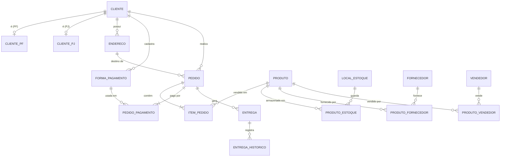

# 🛒 Projeto Lógico de Banco de Dados — E-commerce

Mapeamento do modelo EER de um e-commerce para o **modelo lógico relacional** (MySQL 8), com script de criação, dados de teste e consultas SQL. Desenvolvido como desafio de projeto da DIO.

## Refinamentos aplicados ao modelo

| Refinamento | Mapeamento para o modelo lógico |
|---|---|
| **Cliente PF e PJ** — a conta é PF *ou* PJ, nunca as duas | Especialização disjunta mapeada como **uma tabela por subtipo**: `cliente` (supertipo) + `cliente_pf` + `cliente_pj` |
| **Pagamento** — mais de uma forma cadastrada | `forma_pagamento` (1 cliente : N formas) e `pedido_pagamento` (um pedido pode ser pago com várias formas) |
| **Entrega** — status e código de rastreio | `entrega` com `status_entrega` e `codigo_rastreio`, mais `entrega_historico` |

## Diagrama



## Decisões do mapeamento (EER → relacional)

1. **Especialização PF/PJ.** Optei por uma tabela por subtipo, com a PK do subtipo sendo também FK do supertipo. A exclusividade é garantida no banco: `cliente` tem um discriminador `tipo_cliente`, e cada subtipo tem FK composta `(id_cliente, tipo_cliente)` mais um `CHECK` fixando o seu tipo. Assim, um cliente PF não pode receber linha em `cliente_pj`.
   - *Limitação:* o banco não obriga que todo cliente PF **tenha** linha em `cliente_pf`. Isso deve ser feito inserindo `cliente` + subtipo na mesma transação.
2. **Relacionamentos N:M** viram tabelas associativas com PK composta: `produto_estoque`, `produto_fornecedor`, `produto_vendedor` e `item_pedido`.
3. **Integridade entre tabelas relacionadas.** FKs compostas garantem que o endereço (`pedido`) e a forma de pagamento (`pedido_pagamento`) pertencem ao **mesmo cliente** do pedido.
4. **Preço congelado.** `item_pedido.preco_unitario` guarda o valor da época da compra.
5. **Entrega.** `codigo_rastreio` é `UNIQUE` e opcional até a postagem; um `CHECK` o torna obrigatório a partir de `POSTADO`.
6. **Dados de cartão.** Só são guardados bandeira e 4 últimos dígitos; número completo e CVV ficam com o gateway de pagamento.
7. **Vendedor × fornecedor.** São entidades separadas; a identificação de que um vendedor também é fornecedor é feita pelo **CNPJ** (Q11).

## Constraints principais

- **PK** em todas as tabelas (simples ou composta nas associativas).
- **FK** com `ON DELETE CASCADE` apenas onde o filho não faz sentido sozinho (endereços, formas de pagamento, itens do pedido, histórico de entrega).
- **UNIQUE:** e-mail, CPF, CNPJ, código de rastreio.
- **CHECK:** valores positivos, quantidades válidas, tipo PF/PJ, rastreio obrigatório após postagem.

## Consultas SQL

O arquivo `02-queries.sql` traz 17 queries, cada uma com a pergunta de negócio que responde. Cobrem:

| Cláusula | Exemplos |
|---|---|
| `SELECT` simples | Q1 |
| `WHERE` | Q2, Q8, Q15, Q16 |
| Atributos derivados | Q3 (idade), Q4, Q7 (total do pedido), Q12 (alerta de estoque), Q14 (margem de lucro) |
| `ORDER BY` | Q2, Q5, Q7, Q12, Q14 |
| `HAVING` | Q6, Q8, Q9, Q10, Q15 |
| Junções (`JOIN`, `LEFT JOIN`) | Q4 a Q16 |

Perguntas respondidas, entre outras:
- Quantos pedidos foram feitos por cada cliente? (Q5)
- Algum vendedor também é fornecedor? (Q11)
- Relação de produtos, fornecedores e estoques (Q12)
- Relação de nomes dos fornecedores e nomes dos produtos (Q13)
- Quais pedidos foram pagos com mais de uma forma de pagamento? (Q10)

## Como executar

Requer **MySQL 8.0.16+** (para o `CHECK` ser aplicado). No **DB Fiddle** (MySQL 8.0):

1. Cole o conteúdo de `01-esquema-e-dados.sql` no painel de cima (*Schema SQL*).
2. Cole **uma query por vez** de `02-queries.sql` no painel de baixo (*Query SQL*) e clique em **Run**.

## Estrutura do repositório

```
├── README.md
├── 01-esquema-e-dados.sql
└── 02-queries.sql
```
